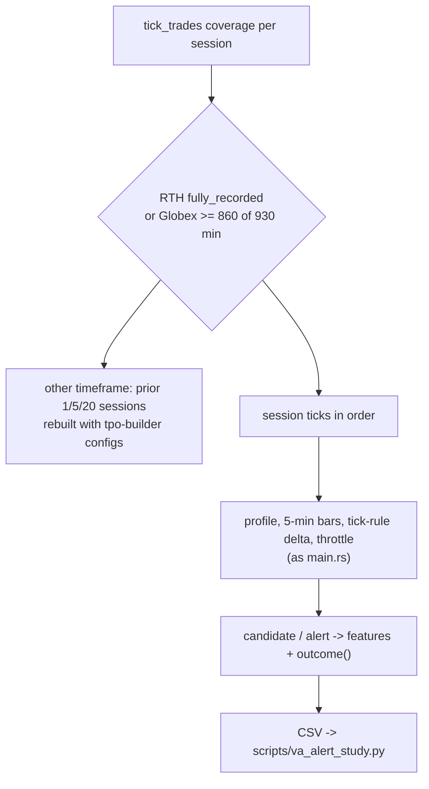

# backtest_va_alert

Source: `src/bin/backtest_va_alert.rs` · New 2026-10-26 (MON-011 study; MON-022 since). Findings:
`bilore-ml-rs/docs/findings/2026-10-26-va-alert-factors.md`.

Replays the value-area alert on recorded ticks exactly as `main.rs` runs it and writes one CSV row
per setup: every alert `va_alert::evaluate` + the throttle would send (`sent = 1`), plus the first
`va_alert::candidate` per period whatever its factors (`cand_first = 1`), with the cockpit's other
readings at that moment and what price did afterwards. Nothing is decided or traded.

| Symbol | Purpose | Tests |
|---|---|---|
| `outcome()` | First favourable/adverse k-point passages, POC reached, MAE before it, 15/30/60-min excursions, move to session end | `a_short_fade_records_first_passages_in_its_favour`, `a_long_fade_that_never_reaches_the_poc_keeps_its_worst_move` |
| `Window::stats()` | Range, move, imbalance and delta over the last N minutes | — |
| `build_tpo()` / `composite()` | Other-timeframe composites from ticks | — |

Usage: `cargo run --release --bin backtest_va_alert -- [--from 2026-03-13] [--out va_alert_study.csv]`,
then `../bilore-ml/.venv/bin/python scripts/va_alert_study.py va_alert_study.csv all pnl_poc_8`.

Fidelity (2026-10-26): 21 of 25 live alerts in the replayed sessions reproduced within 3 minutes, 1
extra; the misses trace to live restarts (session delta rebuilt from a partial replay).
