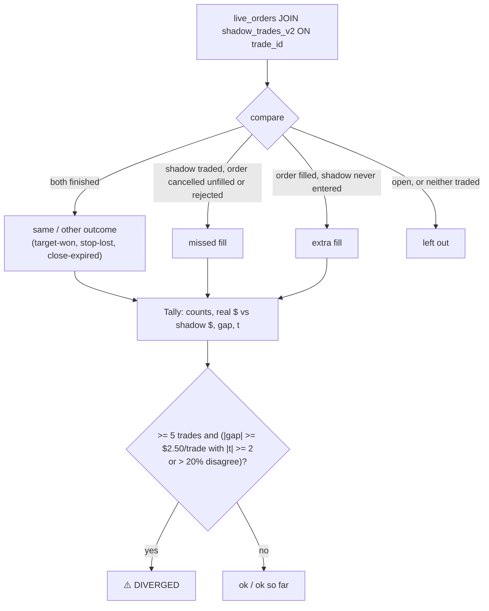

# exec_compare

Source: `src/exec_compare.rs` (pure) · DB read `db::fetch_exec_pairs` · appended to the daily
summary in `main.rs` `send_daily_summary` · New 2026-10-26 (MON-026, user request).

Shadow trades judge the rule; paper and live orders (`live_orders`, keyed by the shadow trade's id)
measure execution. This section shows, per strategy and mode, how far the real orders are from
their shadow trades, and flags a divergence.

| Symbol | Purpose | Tests |
|---|---|---|
| `compare()` | One order vs its shadow trade | `each_order_is_compared_with_its_shadow_trade` |
| `Tally::of()` / `diverged()` | Totals, gap, t; the divergence rule | `small_or_few_gaps_are_not_a_divergence`, `a_consistent_gap_or_too_many_disagreements_is_a_divergence` |
| `section()` | The summary section (Today, Total, verdict) | `the_section_shows_today_the_total_and_the_verdict` |

Notes: `realized_usd` carries no commissions (~$1.24 per MES round trip), so real reads slightly
better than it is. A missed fill counts the shadow trade's $ as the gap (real 0). Thresholds are
first-pass (`MIN_PAIRS`, `GAP_USD`, `T_STAT`, `MAX_DISAGREE`).
