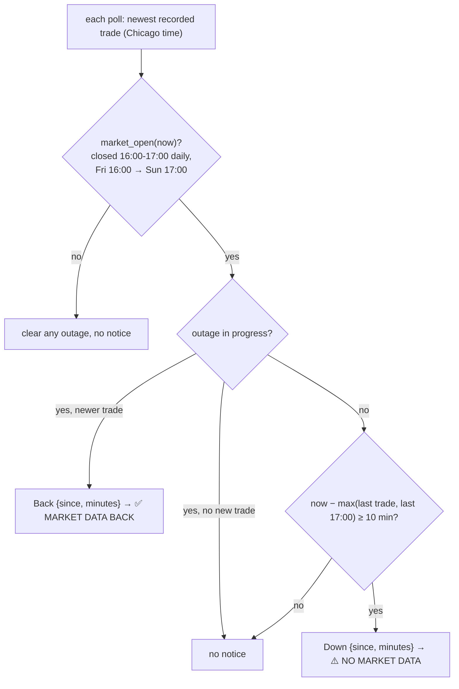

# feed_watch

Source: `src/feed_watch.rs` (pure) · wired in `main.rs` (after each tick poll) · New
2026-10-17 (MON-015, user: "if the auth is not coming let me know in Telegram").

The monitor reads `tick_trades`, so one silence covers every cause: gateway waiting for
phone approval, gateway down, tick recorder stopped. Measured 2026-10-17 on MES since
09-30: a real quiet market almost never goes 10 minutes without a trade (RTH never),
while the feed dropped for ~16 minutes dozens of times and for whole nights. Until those
drops are fixed, expect real alerts.

| Symbol | Purpose | Tests |
|---|---|---|
| `market_open()` | CME equity futures hours, Chicago wall clock | `market_hours_follow_cme_equity_futures` |
| `FeedWatch::check()` | One Down per outage, one Back when trades resume, reopen grace | `ten_minutes_of_silence_while_open_alerts_once`, `quiet_under_ten_minutes_sends_nothing`, `data_back_sends_one_all_clear`, `the_reopen_gets_a_grace_period`, `silence_while_closed_never_alerts` |

Holidays are not modelled: a CME holiday with the market closed will read as an outage.
