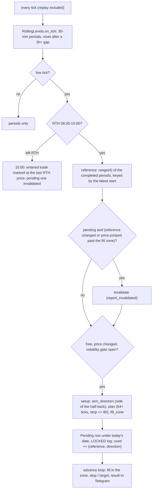

# half_back

Source: `src/half_back.rs` (pure) · wired in `main.rs` (`try_half_back_signal`, the
per-tick `half-back-rth` block) · New 2026-11-07 (MON-028). Strategy `half-back-rth`,
registered in `bilore-project-conf/contracts/strategies.md`. The rule itself is
`bilore_ml_rs::half_back` (ML-011), the code `backtest_half_back` runs.

The Market Profile half-back: once price trades one tick past the midpoint of the last
2 hours' range, it is expected to go all the way to the other end of that range.

| Piece | Value |
|---|---|
| Reference | high-low of the last 4 completed 30-min periods, 64+ ticks |
| Entry | one tick past the half-back, stop-type: fills up to 2 ticks past it, a jump further is a miss |
| Target / stop | one tick before the far extreme / one tick past the near extreme (~1R), stop <= 80 ticks |
| Re-take | each (reference, direction) once; the reference changes at every period close |
| Window | RTH 08:30-15:00 CT, closed at the last RTH price |
| Trust | NULL (every crossed half-back is the same bet) |
| Execution | shadow only: never published to the order executor |

Evidence (bilore-ml-rs findings 2026-11-06-half-back): a year of 1-min bars, 451t, +2.9
ticks/trade, +$1,662, both halves positive (below the 5-tick gate); out of sample (recorded
ticks as 1-s bars) 67t, +7.9 ticks/trade, +$659. Review after ~40 resolved trades.

## Deviations from the backtest

- The volatility block (SYS-006) stops new setups; fills and exits never consult it.
- After a restart the used (reference, direction) pairs are rebuilt from today's rows by
  their arm time (`key_at`: the period completed before the arm time). An open trade's
  reference is rebuilt the same way, so a recorder gap before the restart can cancel a
  restored pending setup.
- A setup is armed on the tick after a resolution (the advance loop runs after the arming),
  not on the same tick.
- `stop_ticks` of a short row is measured from the zone's far end (2 ticks wide).
