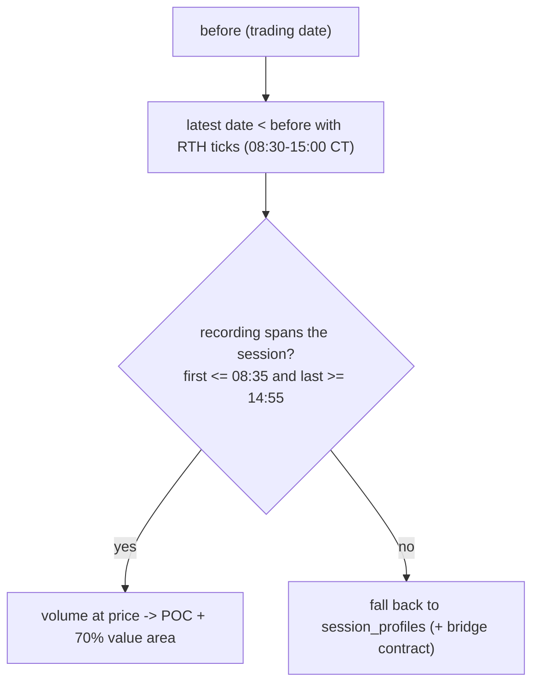

# levels

Source: `src/levels.rs` (pure) + `db::last_rth_volume_profile` (I/O) · New
2026-10-02. Used by `main.rs`'s `fetch_prior_session` for every strategy.

| Function | Contract | Tests |
|---|---|---|
| `rth_levels_from_ticks(rows, first, last, minutes)` | POC/VAH/VAL from volume at price; `None` unless `poc_anchor::fully_recorded` (ticks 08:35 → 14:55 in ≥ 380 of 390 minutes, MON-018) or if empty | `a_fully_recorded_session_gives_its_poc_and_value_area`, `a_partly_recorded_session_is_not_trusted`, `no_ticks_no_levels` |
| `rth_levels_from_ticks_pct(rows, first, last, minutes, pct)` | Same with a `pct`% value area (fade-priorpoc-2r and the profile fades) | `a_60_percent_value_area_is_cut_from_the_same_ticks`, `a_partly_recorded_session_gives_no_60_percent_levels`, `a_session_with_recording_holes_gives_no_levels` |

Why not `session_profiles`: tpo-builder's RTH session has no end, so its
live row includes post-close and early-Globex trading until 19:00 CT
(10-01: true POC 7690 vs row 7730).

## Completeness (MON-018, 2026-10-18)

A first tick by 08:35 and a last after 14:55 are not enough: 2026-10-16 had both and 16 holes
(123 minutes). Levels need ticks in at least 380 of the 390 RTH minutes — the same
`poc_anchor::fully_recorded` rule the profile sweep uses.
