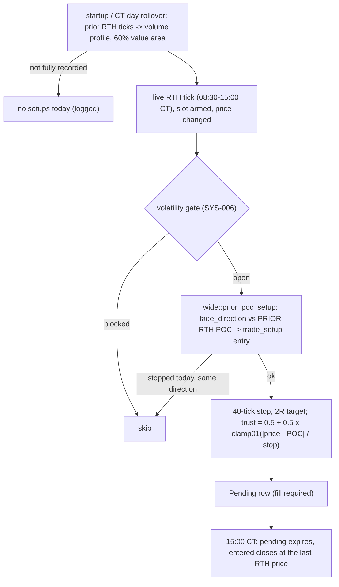

# priorpoc

Source: `src/priorpoc.rs` (pure) · wired in `main.rs` (`try_priorpoc_signal`,
`fetch_prior_rth_pct`, the per-tick RTH block and the 15:00 close) · New 2026-10-18 (MON-016).
Strategy `fade-priorpoc-2r`, registered in `bilore-project-conf/contracts/strategies.md`.

## Rule

The live rule is the 2026-10-17 tick sweep's variant A winner, built from the same pieces:
`levels::rth_levels_from_ticks_pct` uses `poc_anchor::VolumeProfile::value_area_pct` exactly
as `bilore-ml-rs/src/bin/backtest_profile_sweep.rs` does, entries come from `trade_setup`
(tested equal to the sweep's `trade_setup_levels`), and the 15:00 close is
`shadow_trader::close_at_mark` like the sweep's `end_session`. Evidence:
`bilore-ml-rs/docs/findings/2026-10-17-profile-sweep.md` — 116 trades, 40.6%, +$1,005,
max DD -$420, H1 +$283 / H2 +$723 (in-sample, 1,200 combos).

## Function index

| Symbol | Purpose | Tests |
|---|---|---|
| `VA_PCT` | 60 | `levels::tests::a_60_percent_value_area_is_cut_from_the_same_ticks` |
| `geometry()` | 40-tick stop, 2R | via `setup` tests |
| `setup()` | Direction, entry, stop, target or why not | `above_the_prior_poc_it_sells_with_a_40_tick_stop_and_2r_target`, `below_the_prior_poc_it_buys_with_a_40_tick_stop`, `a_stopped_level_is_not_retaken_by_priorpoc` |
| `trust()` | Registry entry trust (row confidence) | `priorpoc_trust_is_the_extension_beyond_the_prior_poc_over_its_40_tick_stop` |
| `in_rth()` | 08:30 <= t < 15:00 CT | `it_trades_only_from_08_30_to_15_00` |
| `close_at_rth_end()` | Sweep's session end | `at_15_00_an_entered_trade_closes_at_the_last_rth_price`, `at_15_00_a_pending_setup_expires` |

## Known deviations / scope notes

- Live applies SYS-006 (no new setups 08:30-09:00, around US releases or in 30-second
  spikes); the sweep had no such block.
- No `session_profiles` fallback: after an incompletely recorded RTH session, or on a
  contract-roll day before the new contract has a recorded RTH, it arms nothing.
- If the monitor is down at 15:00, the first later tick closes the trade at the last RTH
  price seen in the replay (or that tick's price).
