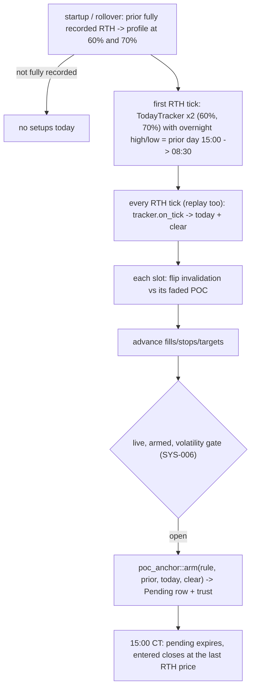

# profile_fade

Source: `src/profile_fade.rs` (pure) · wired in `main.rs` (`PfSlot`, `PfPrior`,
`fetch_pf_prior`, `try_pf_signal`, the per-tick MON-017 block) · New 2026-10-18 (MON-017).
Five configured strategies, one slot each (two retired 2026-10-18, MON-019: they stay in `configs()` but `is_active` is false), registered in `bilore-project-conf/contracts/strategies.md`.

## Rule

The per-tick state and the arming are `bilore_ml_rs::poc_anchor::TodayTracker` and `arm`
(ML-007), the code `backtest_profile_sweep` runs; its re-run on that code reproduced every
published number (bilore-ml-rs `docs/findings/2026-10-17-profile-sweep.md`, "Re-validation").

| Slug | Variant | VA | Stop / target | Re-take | Trust from | Sweep (109 sessions) |
|---|---|---|---|---|---|---|
| `fade-devpoc-sw` | C stable | 60 | 120t / 1R | no | faded POC | 167t, +$2,721 |
| `fade-devpoc-anchor-2r` | E+C | 60 | 40t / 2R | **yes** | nearest today level | 441t, +$2,735 |
| `fade-devpoc-live-va` | E+C | 70 | 120t / 0.75R | **yes** | faded POC | 252t, +$2,048 |
| `fade-devpoc-0930` | C 09:30 | 60 | 120t / 1R | no | faded POC | 175t, +$996 |
| `fade-todaylvl-0.75r` | E | 60 | 60t / 0.75R | **yes** | nearest today level | 361t, +$834 |

## Function index

| Symbol | Purpose | Tests |
|---|---|---|
| `configs()` | The five rules | `the_five_profile_fades_are_the_sweep_winners` |
| `faded_poc()` | Prior POC until a handoff variant is clear, then the developing one | `a_stable_poc_fade_leans_on_the_prior_poc_until_clear_then_the_developing_one` |
| `setup()` | `poc_anchor::arm` with the faded POC's direction | same + `todays_levels_add_entry_anchors` |
| `trust()` | Registry entry trust | `profile_fade_trust_follows_the_registry` |

## Known deviations / scope notes

- Live applies SYS-006 (no new setups 08:30-09:00, around US releases, in spikes); the sweep didn't.
- The three re-take rules are deliberate exceptions to the 2026-09-30 no-re-take rule.
- A restart rebuilds today's tracker from the startup replay; if the replay doesn't reach back
  to 08:30 the developing profile would be partial (the replay covers 12 hours).
- No `session_profiles` fallback, as for fade-priorpoc-2r.
