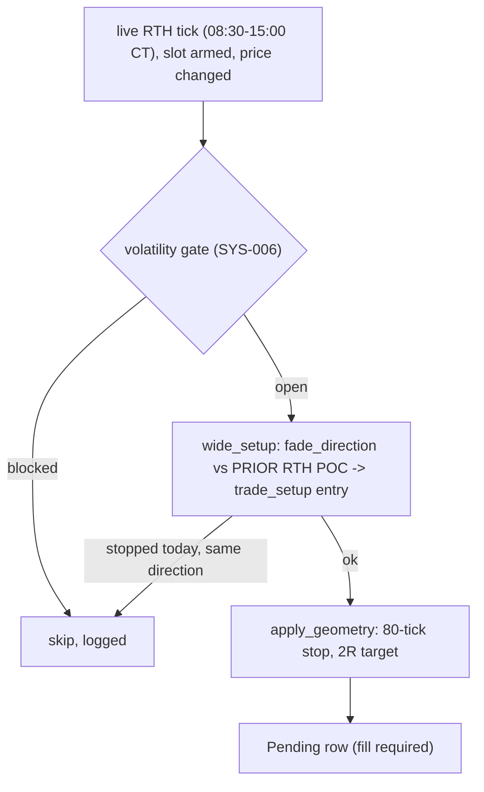

# wide

Source: `src/wide.rs` (pure) · wired in `main.rs` (`try_wide_signal`, the per-tick RTH
block) · New 2026-10-12 (MON-014). Strategy `fade-poc-wide`, registered in
`bilore-project-conf/contracts/strategies.md` as `fade-poc-fill`'s replacement.

## Rule

Same entries as `fade-poc-fill`; only the stop and target differ. The geometry is the
stop/target sweep's best for this rule (`backtest_poc_geometry`, IBKR 5-min bars
2025-09-11..2026-09-30): 286 trades, 31.9%, +2.1 ticks/trade, +$736, but H1 +$1,510 /
H2 -$774 — a forward test, not a proven edge. Flip invalidation (4-tick buffer), the
no-re-take rule, restore on restart and the CT-day rollover work as for the other slots.

## Function index

| Symbol | Purpose | Tests |
|---|---|---|
| `geometry()` | 80-tick stop, 2R | via `wide_setup` tests |
| `wide_setup()` | Direction, entry, stop, target or why not (`prior_poc_setup` with `geometry()`) | `above_the_prior_poc_it_sells_with_an_80_tick_stop_and_2r_target`, `below_the_prior_poc_it_buys_with_an_80_tick_stop`, `a_level_stopped_out_today_is_not_retaken` |
| `prior_poc_setup()` | The shared prior-POC fade with any geometry; also used by `priorpoc` (fade-priorpoc-2r) | via `wide` and `priorpoc` tests |

## Known deviations / scope notes

- Like the other RTH slots, an open trade is closed at the CT-midnight rollover, not at
  15:00 (known issue KI-4).
- Not published to the cockpit (no `LiveModelState`); its trades show in the scoreboard
  and Telegram results.
